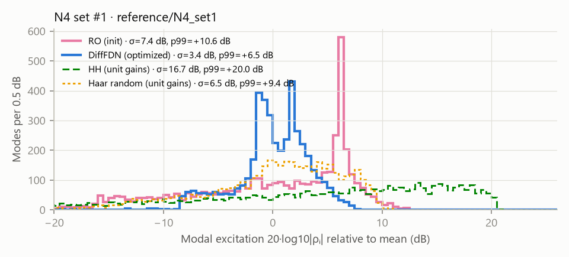
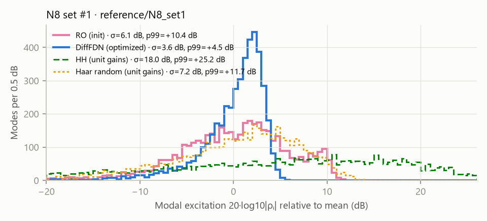
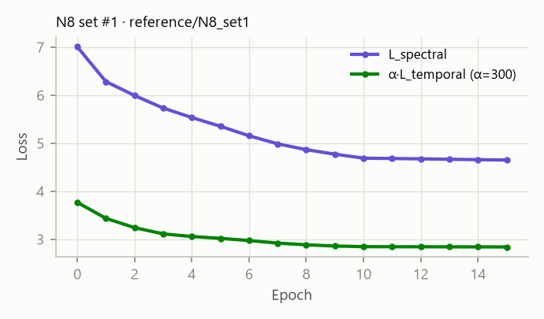
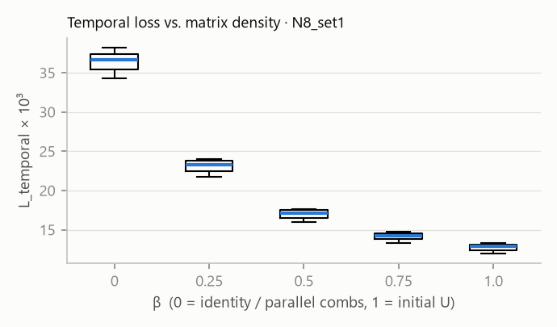

# Reproducing Dal Santo et al., "Differentiable FDN for Colorless Reverberation" (DAFx23)

## Verdict

The paper's optimization reproduces. We ran the authors' own DAFx23 code, unmodified, on all six configurations of
Table 1. Every run narrows the modal-excitation distribution (σ from 5.9–7.8 dB to 3.4–4.4 dB) and pulls in the
loudest modes by 4.7–9 dB, against "about 3 dB" in the paper's Fig. 6. Loss curves and the effect of the temporal
term (Figs. 4 and 5) behave as described. Our numbers fall in the same range as the five optimized parameter sets
the authors published in their repository, which we evaluated with the same tools. The improvement also holds
against typical random orthogonal matrices (20 Haar draws per delay set: σ = 7.0–7.5 dB). Optimization also raises
early echo density, and the result is denser than Householder or a Haar draw in every configuration.

Three things the paper doesn't say, which matter for building on it:

1. **The initialization is close to the identity**, not a random orthogonal matrix. The paper's "RO" listening-test
   condition (the init) was a weakly coupled matrix (‖diag U‖²/N = 0.77–0.86, against 0.06–0.27 for a Haar draw).
   Its modal spread is still typical of random matrices, so the RO comparison is fair on that measure. On echo density
   it is mixed: for N = 6 and 8 the init is sparser early on than a Haar draw, for N = 4 it is not.
2. **The modal-excitation spread alone does not measure coloration across matrix classes.** A diagonal matrix
   (parallel comb filters, the listening test's anchor) has the narrowest distribution of all (σ ≈ 1.6 dB). The
   metric is only meaningful together with a mixing or density measure.
3. **The code's loss differs from the paper's equation (17)** in two places: an extra term on the summed response,
   and unmasked zero-padded frequency bins (details below).

The listening test itself was not repeated. The [previewer](../README.md#previewer) plays the paper's conditions
(DiffFDN, RO init, Householder, plus Haar-random, Hadamard, a comb-bank anchor and a noise reference) at the
paper's two decay settings, so the comparison can be heard.

## What was run

| | Paper | This reproduction |
|---|---|---|
| Code | github.com/gdalsanto/diff-fdn-colorless | branch `dafx23` @ `d4dc2f25`, run unmodified through `scripts/run_reference.py` (stubs `torchaudio.save` only) |
| Configurations | Table 1: N = 4, 6, 8 × two delay sets | the same six |
| fs, K, M range | 48 kHz, K = 480 000, M ~ U[0.8K, K] | same (solver defaults) |
| Data | 256 sizes M, 80/20 split, batch 4 | same |
| Optimizer | Adam, lr 1e-3, 15 epochs | same, plus StepLR ×0.1 after epoch 10 (in the code, not in the paper) |
| γ during training | 0.9999 (T60 = 1.439 s) | same |
| α (temporal weight) | "chosen so both losses have similar magnitude" | 300 (code default; the authors' published sets use 200–300) |
| Seed | – | the solver's fixed seed 130798 |
| Hardware | – | GTX 1660 SUPER (6 GB), torch 2.14.1+cu126; 13 s/epoch (N = 4), 16–19 s (N = 6), 65 s (N = 8, memory-bound) |

Outputs are in `runs/reference/<config>/` (parameters, per-epoch checkpoints, losses, IR) and in the previewer.

## How the results were evaluated

**Modal decomposition** (`fdnopt/modal.py`). The paper's objective evaluation uses the modal excitation |ρᵢ|, computed with
fdnToolbox in MATLAB. We reimplemented it in Python and validated it two ways:

- Against the poles and residues the authors computed with fdnToolbox for `demo/pretrained00` (8944 modes,
  init and optimized): pole angles agree to 1e-10 rad, residue magnitudes to < 0.001 dB.
- Against the time-domain impulse response: Σρᵢλᵢⁿ reproduces h(n) for n ≥ 1 to 1e-13, Householder included
  (which has a 3-fold pole at z = −γ and an unexcited 3-fold pole at z = +γ).

The fast path uses a property of homogeneous FDNs with orthogonal U. The poles are γ times the eigenvalues of
the lossless system. On the unit circle the eigenphases of diag(e^{−jωm})U decrease monotonically in ω, so the
number of poles in (0, ω] is the integer (Mω + Σφₖ(ω) − Σφₖ(0))/2π, which needs only an N×N eigendecomposition.
Poles are isolated on a grid, located by bisection, polished with Newton, and the residues come from the null
vectors of P(λ) = diag(λᵐ) − A. It gives the same result in 3 s that a dense M×M eigendecomposition gives in 122 s.

**Metrics** (`fdnopt/metrics.py`), all at the training γ:

- Modal excitation 20·log10|ρᵢ| relative to its mean: standard deviation σ, 99th percentile, maximum, share of modes
  more than 6 dB above the mean. Modes with zero residue (orthogonal to b or c) are excluded.
- Mixing ‖diag U‖²/N: 1 for the identity (parallel combs), about 1/N for a dense matrix.
- ‖h‖₂/‖h‖₁ of the IR (the paper's temporal loss; lower is denser).
- Normalized echo density (Abel & Huang, 20 ms window) averaged over 0.1–0.5 s and 0.5–1 s.

Baselines: Householder with unit gains (the paper's HH condition), one Haar-random orthogonal draw with unit gains,
and 20 Haar draws per delay set for the distribution (`scripts/baseline_stats.py`).

## Results

### Fig. 6: modal excitation narrows, the loudest modes come down

| Configuration | M | σ | p99 | loudest mode | modes > +6 dB | Haar random σ (20 draws) | Haar p99 | Householder σ / p99 |
|---|---|---|---|---|---|---|---|---|
| N4 set #1 | 8768 | 7.35 → **3.41** | +10.56 → **+6.49** | +12.50 → **+7.80** | 28.5% → **1.8%** | 7.03 ± 1.41 | +10.23 ± 1.96 | 16.70 / +20.00 |
| N4 set #2 | 7016 | 7.80 → **3.71** | +11.64 → **+6.47** | +13.85 → **+8.06** | 16.8% → **2.1%** | 7.14 ± 1.61 | +10.92 ± 2.43 | 16.25 / +19.88 |
| N6 set #1 | 8936 | 5.86 → **3.45** | +9.75 → **+4.81** | +12.81 → **+5.68** | 17.6% → **0.0%** | 7.32 ± 0.90 | +11.60 ± 1.46 | 17.61 / +23.46 |
| N6 set #2 | 8442 | 6.22 → **3.88** | +10.11 → **+5.72** | +13.27 → **+7.69** | 20.1% → **0.7%** | 7.28 ± 0.96 | +11.74 ± 1.47 | 17.52 / +23.53 |
| N8 set #1 | 8944 | 6.08 → **3.63** | +10.36 → **+4.47** | +11.79 → **+5.92** | 15.4% → **0.0%** | 7.42 ± 0.40 | +12.46 ± 1.15 | 17.97 / +25.21 |
| N8 set #2 | 6640 | 6.16 → **4.43** | +10.99 → **+6.31** | +16.51 → **+7.46** | 20.2% → **1.6%** | 7.54 ± 0.34 | +13.20 ± 1.36 | 17.73 / +25.68 |
| N8 set #1, authors' pretrained00 (α 300, 15 ep) | 8944 | 9.46 → **4.32** | +14.57 → **+6.01** | +17.34 → **+7.12** | 34.0% → **1.1%** | | | |
| N8 set #1, authors' pretrained01 (α 300, 20 ep) | 8944 | 6.23 → **2.76** | +10.74 → **+3.96** | +14.01 → **+5.34** | 17.5% → **0.0%** | | | |
| N8 set #2, authors' pretrained02 (α 300, 20 ep) | 6640 | 8.81 → **5.04** | +15.37 → **+7.22** | +20.75 → **+9.42** | 26.3% → **4.5%** | | | |
| N8 set #2, authors' pretrained03 (α 200, 20 ep) | 6640 | 8.72 → **5.24** | +23.32 → **+8.05** | +24.87 → **+10.84** | 23.1% → **6.5%** | | | |
| N8 set #2, authors' pretrained04 (α 250, 20 ep) | 6640 | 7.13 → **4.06** | +13.10 → **+4.62** | +17.91 → **+7.33** | 17.3% → **0.1%** | | | |

All values are dB relative to the mean of 20·log10|ρᵢ|, init → optimized. The paper's Fig. 6 (N = 4) describes the
loudest modes dropping by about 3 dB and the distribution's peak moving to ~1 dB. Here every run does at least as well:
the 99th percentile drops by 4–6 dB and the share of modes more than 6 dB above the mean falls from 15–29% to
0–2%. Our init distributions differ in shape from the paper's (a different random draw), but they sit inside the
spread of the Haar baseline. Householder with unit gains is by far the widest (σ ≈ 17 dB): b = c = 1 is an
eigenvector of the Householder matrix, so the input couples very unevenly into the modes.

### Mixing and echo density

| Configuration | ‖diag U‖²/N (dense ≈ 1/N) | ‖h‖₂/‖h‖₁ ×10³ | NED 0.1–0.5 s | NED 0.5–1 s | Householder NED 0.1–0.5 s | Haar draw NED 0.1–0.5 s |
|---|---|---|---|---|---|---|
| N4 set #1 | 0.86 → **0.81** (1/N = 0.25) | 59.12 → **34.81** | 0.12 → **0.16** | 0.32 → **0.42** | 0.09 | 0.06 |
| N4 set #2 | 0.86 → **0.64** (1/N = 0.25) | 38.06 → **28.69** | 0.24 → **0.30** | 0.46 → **0.63** | 0.16 | 0.11 |
| N6 set #1 | 0.80 → **0.58** (1/N = 0.17) | 24.81 → **14.07** | 0.40 → **0.65** | 0.65 → **0.92** | 0.47 | 0.49 |
| N6 set #2 | 0.80 → **0.55** (1/N = 0.17) | 23.36 → **15.15** | 0.43 → **0.67** | 0.68 → **0.93** | 0.47 | 0.51 |
| N8 set #1 | 0.77 → **0.34** (1/N = 0.12) | 15.99 → **11.40** | 0.63 → **0.89** | 0.94 → **1.00** | 0.82 | 0.87 |
| N8 set #2 | 0.77 → **0.38** (1/N = 0.12) | 12.20 → **10.74** | 0.78 → **0.95** | 0.95 → **1.00** | 0.88 | 0.94 |

The paper's claim that the optimized FDN keeps its impulse-response density holds, and density actually improves:
the ℓ2/ℓ1 ratio drops and the normalized echo density rises in every configuration, to above Householder's and a
Haar draw's. Optimization also mixes the delay lines more (‖diag U‖²/N falls), but the N = 4 results stay
diagonal-dominant (0.64–0.81), far from a dense matrix.

The modal spread and the mixing measure have to be read together. A diagonal matrix with unit gains (parallel combs,
the paper's anchor) has σ = 1.7 dB for N4 set #1 and 1.6 dB for N8 set #1, narrower than any optimized FDN, because
each comb excites all its modes equally. In that case a narrow spread means periodicity, which is what sounds
metallic.

### Fig. 5: loss components per epoch

Evaluated from the saved checkpoints on a fixed batch of 8 frequency-sampling sizes (`scripts/loss_curves.py`):

| Configuration | L_spectral init → epoch 1 → final | α·L_temporal init → epoch 1 → final |
|---|---|---|
| N4 set #1 | 4.088 → 3.631 → 2.296 | 8.906 → 7.643 → 5.511 |
| N4 set #2 | 5.693 → 4.203 → 2.674 | 5.907 → 5.352 → 4.738 |
| N6 set #1 | 5.317 → 4.872 → 3.421 | 5.018 → 4.266 → 3.080 |
| N6 set #2 | 5.408 → 4.950 → 3.544 | 4.691 → 4.097 → 3.274 |
| N8 set #1 | 7.007 → 6.284 → 4.648 | 3.766 → 3.434 → 2.838 |
| N8 set #2 | 8.352 → 6.840 → 5.545 | 3.118 → 3.128 → 2.783 |

As in the paper, the spectral term keeps decreasing while the temporal term settles after a few epochs. Both flatten
after epoch 10, where the code's StepLR cuts the learning rate. The total training loss of our N8 set #1 run
(10.20 → 7.50) tracks the authors' saved losses for the same configuration (pretrained00: 10.29 → 7.52,
pretrained01: 9.75 → 7.42).

### Fig. 4: the temporal loss penalizes sparse matrices

Matrices interpolated between the identity and the N8 set #1 init, A_β = expm(β·logm(U)), evaluated at 32 sizes M:

| β | 0 (identity) | 0.25 | 0.5 | 0.75 | 1 (U) |
|---|---|---|---|---|---|
| median L_temporal ×10³ | 36.6 | 23.3 | 17.1 | 14.3 | 12.9 |

The loss falls monotonically as the matrix gets denser, as in the paper's figure.

### Listening test (Figs. 7–10)

Not repeated. The previewer can play the same conditions (DiffFDN, RO init, Householder, Haar random, Hadamard,
comb-bank anchor, noise reference) at the paper's two decay settings, with time-aligned A/B switching.

## Differences between the paper and the code

- **Initialization.** The paper says W, b and c are drawn from N(0, N⁻¹). `weights_init_normal` draws W with
  *standard deviation* 1/N (variance N⁻²), and `expm(triu(W,1) − triu(W,1)ᵀ)` of such a small W is near the
  identity: ‖diag U‖²/N = 0.72–0.86 against ≈1/N for a Haar-random matrix. b and c are then rescaled for unit
  mean energy of H.
- **Spectral loss.** The code adds the asymmetric p-loss of the *summed* response to the per-channel terms of
  eq. (17), weighted by √batch_size (= 2).
- **Zero padding enters the spectral loss.** Each sample's frequency vector is zero-padded from M to K. At z = 0,
  D(z) = 0, so every padded bin evaluates each channel to the constant cᵢ·(−(UΓ)⁻¹b)ᵢ. The time-domain path masks
  these bins but the spectral loss does not, so 0–20% of each sample's bins pull |cᵢ(Γ⁻¹Uᵀb)ᵢ| towards 1.
- **Learning-rate schedule.** StepLR divides the learning rate by 10 after epoch 10, which explains the knee in the
  loss curves.
- **Which configuration Fig. 5 shows** is not stated. Its values (L_spectral 3.5 → 1.7, L_temporal 2.6 → 2.2) are
  on the same scale as ours, which depend on the configuration: L_spectral 4.1–8.4 → 2.3–5.5, α·L_temporal
  3.1–8.9 → 2.8–5.5.

## Figures

- `docs/figures/modal_<run>.png`: Fig. 6 style histograms for every run, with the Householder and Haar baselines.
- `docs/figures/loss_<run>.png`: Fig. 5 style loss components per epoch.
- `docs/figures/fig4_temporal_vs_beta_N8_set1.png`: Fig. 4, temporal loss for matrices interpolated between I and U.

## Reproduce

See the [README](../README.md#reproduce). Tables in this file come from `scripts/report_tables.py`.
